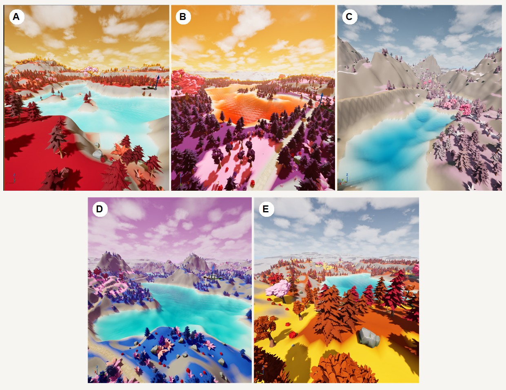
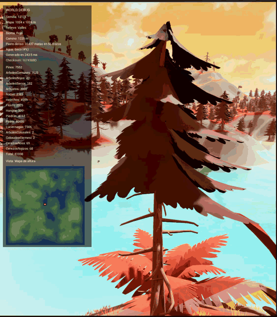

# Jardín procedural 3D

Generador procedural de un entorno natural en **Unreal Engine 5.7**. A partir de una semilla, el programa calcula un jardín de 1024 × 1024 m con relieve, lagos, un sendero, zonas de pradera y bosque, vegetación y árboles fractales. La persona lo recorre en primera persona y a su ritmo, como un espacio de descanso visual. La misma semilla con la misma configuración vuelve a dar el mismo jardín.

Proyecto final de **Graficación por Computadora**, IPN ESCOM, grupo 6CV3.
Autor: Habid Portocarrero Rodríguez. Profesora: Rosaura Palma Orozco.





## Contenido

- [Qué hace](#qué-hace)
- [Requisitos](#requisitos)
- [Instalación y ejecución](#instalación-y-ejecución)
- [Controles](#controles)
- [Reproducir un jardín y verificar el determinismo](#reproducir-un-jardín-y-verificar-el-determinismo)
- [Pruebas del núcleo sin Unreal](#pruebas-del-núcleo-sin-unreal)
- [Estructura del repositorio](#estructura-del-repositorio)
- [Autoría y uso de IA](#autoría-y-uso-de-ia)
- [Créditos y licencias](#créditos-y-licencias)

## Qué hace

El proyecto tiene dos capas:

1. **Núcleo en C++** (`unreal/Source/Jardin/Core/`). Es C++17 sin una sola cabecera de Unreal y calcula todo el mundo:
   - Relieve con ruido de Perlin por octavas (fBm), *domain warping* y estilos de relieve.
   - Agua: Priority-Flood llena las depresiones y forma lagos.
   - Sendero: Dijkstra sobre el terreno, esquivando el agua y prefiriendo pendientes suaves, suavizado con Catmull–Rom centrípeta.
   - Humedad, pendiente y zonas de pradera o bosque.
   - Colocación de objetos con rejilla espacial y reglas por capa.
   - Árboles fractales por ramificación recursiva.
   - Pasto procedural por trozos.
   - Semillas derivadas con FNV-1a y xorshift32, para que todo sea determinista.
2. **Capa de Unreal** (`unreal/Source/Jardin/`). Convierte esos datos en mallas (`ProceduralMeshComponent`), instancias (HISM), materiales y colisiones. Añade el personaje en primera persona y el panel de depuración **World Debug**.

El diseño completo, las pruebas y las mediciones están en el informe técnico, que se entrega aparte.

## Requisitos

| Componente | Versión o detalle |
|---|---|
| Sistema operativo | Windows 10 u 11, 64 bits |
| Motor | Unreal Engine **5.7** (Epic Games Launcher) |
| Compilador | Visual Studio 2022 con la carga de trabajo **Desarrollo de juegos con C++** |
| .NET Framework | SDK 4.6 o superior y su paquete de compatibilidad (*targeting pack*), desde Visual Studio Installer → Componentes individuales. Sin él, UnrealBuildTool falla con `Could not find NetFxSDK install dir`. |

Los plugins necesarios (`ProceduralMeshComponent`, `PythonScriptPlugin` y `EditorScriptingUtilities`) vienen con el motor y ya están activados en `Jardin.uproject`.

## Instalación y ejecución

1. Clona o descarga el repositorio.
2. Haz clic derecho en `unreal/Jardin.uproject` → **Generate Visual Studio project files**.
3. Compila el módulo de una de estas dos formas:
   - Abre `unreal/Jardin.sln` en Visual Studio y compila la configuración **Development Editor | Win64**.
   - O desde una terminal, cambiando `<ruta>` por la carpeta del repositorio:

     ```bat
     "C:\Program Files\Epic Games\UE_5.7\Engine\Build\BatchFiles\Build.bat" JardinEditor Win64 Development -Project="<ruta>\unreal\Jardin.uproject" -WaitMutex
     ```

   La primera compilación tarda varios minutos.
4. Abre `unreal/Jardin.uproject`. El editor carga el nivel `L_Fase0`, que ya contiene el `JardinWorldActor` con los materiales y las capas de vegetación.
5. Pulsa **Play**. Para medir rendimiento sin el costo del editor, usa **Play → Standalone Game**.

Cada vez que se entra en Play se genera un jardín con semilla aleatoria. Para usar siempre la misma, desactiva `Random Seed On Begin Play` en el actor.

## Controles

| Tecla | Acción |
|---|---|
| W A S D o flechas | Caminar |
| Ratón | Mirar |
| Shift izquierdo | Correr |
| Espacio | Saltar |
| N | Generar un jardín con una semilla nueva |
| R | Regenerar el jardín con la misma semilla |
| Tab | Cambiar la vista del minimapa: normal, altura, humedad, pendiente, zonas, fronteras de zona, distancia al agua y camino |
| H | Mostrar u ocultar el panel World Debug |
| B | Iniciar o detener la prueba de rendimiento. Mientras corre, N y R no regeneran. |

El panel World Debug muestra la semilla, el tamaño del mapa, el relieve, el bioma, el sendero, el agua, el tiempo de generación, el checksum y los objetos por capa.

## Reproducir un jardín y verificar el determinismo

- **Volver a un jardín:** anota la semilla que muestra el panel. Escríbela en `Settings → Seed` del `JardinWorldActor`, desactiva `Random Seed On Begin Play` y pulsa **Generate** en el inspector. Con la misma configuración y la misma versión del código se obtiene el mismo terreno.
- **Comprobar el determinismo:** pulsa **Check Determinism** en el inspector del actor. Genera tres veces con la semilla actual y una vez con la siguiente, y escribe el resultado en el Output Log:

  ```
  [Determinismo] CORRECTO. Semilla <n> -> <checksum>, estable en 3 ejecuciones. ...
  ```

- **Valor de referencia:** con la configuración base (semilla 827461, mapa de 128 m, resolución 192, agua y camino apagados), el checksum es `64C68E3D`. Es el mismo valor que da el núcleo compilado aparte y la versión de referencia en Unity. El módulo se compila con `/fp:precise` (ver `Jardin.Build.cs`) para conservar esa igualdad.

## Pruebas del núcleo sin Unreal

`unreal/Tests/build_and_run.bat` compila el núcleo con `cl.exe` y corre dos programas de prueba:

- `HarnessCore.cpp`: terreno, zonas, colocación, agua, sendero y pasto, incluido el checksum `64C68E3D`.
- `HarnessFractal.cpp`: el árbol fractal.

Haz doble clic en el archivo o ejecútalo desde `cmd` en esa carpeta. Cada caso imprime `PASA` o `FALLA`. Si Visual Studio no está en la ruta por defecto, cambia la variable `VCVARS` al inicio del script.

Estas pruebas demuestran que los algoritmos funcionan por sí solos, fuera del motor.

## Estructura del repositorio

```
jardin_3d/
├── README.md
├── CREDITOS.md                   recursos externos y licencias
├── Figura_1_Resultados.jpg       capturas del prototipo
├── informe_figuras/              figuras del informe (HUD, animación)
├── unreal/
│   ├── Jardin.uproject
│   ├── Config/                   nivel inicial, modo de juego, entradas
│   ├── Content/                  nivel L_Fase0, materiales y modelos importados
│   ├── Scripts/                  construir_jardin.py y atmosfera.py (editor)
│   ├── SourceArt/                kit original de Quaternius y su licencia
│   ├── Source/Jardin/
│   │   ├── Core/                 NÚCLEO en C++ plano, sin Unreal
│   │   │   ├── JardinCore        hash, RNG, SeedBook, ruido, fBm
│   │   │   ├── JardinWorld       configuración, campos, relieve, zonas
│   │   │   ├── JardinWater       Priority-Flood y distancia al agua
│   │   │   ├── JardinPath        Dijkstra, Catmull–Rom, cinta del sendero
│   │   │   ├── JardinScatter     rejilla espacial y reglas de colocación
│   │   │   ├── JardinFractalTree árbol por ramificación recursiva
│   │   │   └── JardinGrass       pasto procedural
│   │   ├── JardinWorldActor      mallas, instancias, paletas, mapas de depuración
│   │   ├── JardinCharacter       personaje en primera persona
│   │   ├── JardinHUD             panel World Debug
│   │   └── JardinGameMode, JardinTypes
│   └── Tests/                    pruebas del núcleo con cl.exe
└── unity/                        versión de referencia en C# (prototipo inicial)
```

Los scripts de `unreal/Scripts/` se ejecutan en el editor desde **Tools → Execute Python Script**. `construir_jardin.py` importa el kit de Quaternius, crea los materiales y reconstruye las capas de vegetación. `atmosfera.py` configura la luz, la niebla y el post-proceso. No hace falta correrlos para usar el proyecto, porque el nivel ya está construido; sirven para rehacerlo desde cero.

## Autoría y uso de IA

El proyecto fue dirigido por el autor. Él definió el jardín y su propósito, decidió el alcance de cada fase, eligió y descargó los recursos externos, ejecutó las pruebas y aprobó cada resultado en Unreal.

El código se escribió con **Claude** (Anthropic), bajo la dirección del autor. **ChatGPT** se usó para revisar el informe contra la rúbrica. El detalle de qué hizo cada herramienta está en la sección «Uso de Herramientas de IA» del informe técnico.

## Créditos y licencias

- **Vegetación y rocas:** *Stylized Nature MegaKit* (Standard) de [Quaternius](https://quaternius.com), con licencia **CC0 1.0**. La licencia está en `unreal/SourceArt/Quaternius_StylizedNature/License_Standard.txt`.
- **Motor:** Unreal Engine 5.7, de Epic Games.
- La idea de las tonalidades del follaje fue de una amiga del autor.

El detalle de los modelos y texturas usados está en [CREDITOS.md](CREDITOS.md).
